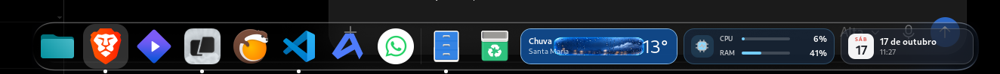
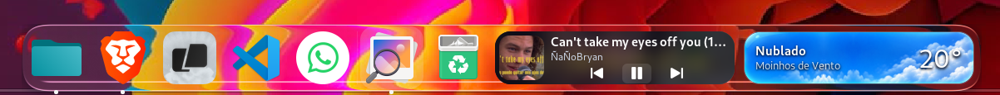
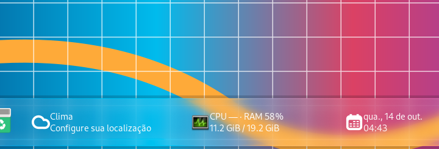

<div align="center">
  
  <h1>MacDock</h1>
  <p><strong>Dock para GNOME Shell com visual refinado, widgets integrados e acabamento Liquid Glass.</strong></p>
  <p>
    
    
    
  </p>
</div>

---

## Resumo

O **MacDock** é um dock para **GNOME Shell 46** com foco em três pilares:

- **visual mais elegante e consistente**;
- **configuração simples**, com prévia de posição e tamanho;
- **widgets nativos integrados**, como clima, sistema, calendário e música.

Além do dock em si, o projeto também inclui um conjunto de ajustes visuais e um acabamento de estilo **Liquid Glass**, buscando uma experiência mais polida no desktop.

---

## Destaques

- Dock com visual refinado para GNOME;
- Widgets integrados no próprio dock;
- Ajuste rápido de **posição** e **tamanho** do dock;
- Janela de configuração reorganizada e mais limpa;
- Integração visual com efeito **Liquid Glass**;
- Foco em uso real, estabilidade e iteração contínua.

---

## Galeria

### Dock principal



### Liquid Glass — refração



### Liquid Glass — widgets



---

## O que o projeto oferece

### Dock
- posição configurável;
- ajuste de escala/tamanho;
- favoritos e apps abertos;
- comportamento integrado ao fluxo do GNOME.

### Widgets
- **Clima** com cenas visuais próprias;
- **Sistema** com CPU e RAM;
- **Calendário** com data e anotações;
- **Música** com integração de reprodução.

### Visual
- acabamento inspirado em superfícies translúcidas;
- elementos com cantos arredondados e contraste mais consistente;
- configuração visual centralizada.

---

## Status do projeto

O MacDock está em evolução contínua.
A versão **1.4.7** está em fase de validação pública. O trabalho continua focado em:

- estabilidade;
- consistência visual;
- melhor experiência de configuração;
- evolução gradual para uma versão 1.0.

---

## Instalação

**Compatibilidade declarada:** GNOME Shell 46. O pacote público ainda precisa de validação funcional antes da submissão ao catálogo oficial do GNOME.

1. Acesse [Releases](https://github.com/Wellingtn/MacDock/releases) e baixe o **anexo instalável** `MacDock-v1.4.7-INSTALAR.zip` da versão `v1.4.7`.
2. No terminal, execute:

```bash
gnome-extensions install --force "$HOME/Downloads/MacDock-v1.4.7-INSTALAR.zip"
```

3. Encerre a sessão GNOME e entre novamente. Se necessário, habilite a extensão:

```bash
gnome-extensions enable macdock@wellingtn.github.io
```

> **Atenção:** o arquivo ZIP gerado automaticamente pelo GitHub em **Source code (zip)** não é o ZIP de instalação. Se a Release ainda não tiver o anexo `MacDock-v1.4.7-INSTALAR.zip`, o download instalável não foi publicado. Não mantenha duas extensões de dock habilitadas simultaneamente.

Para backup, restauração e orientações sobre o UUID público, consulte [Instalação e restauração](INSTALAR-E-RESTAURAR.md).

---

## Estrutura do projeto

- `extension.js` — ponto principal da extensão;
- `prefs.js` — janela principal de preferências;
- `dockStudio.js` — configuração rápida de layout;
- `widgetPrefs.js` — preferências dos widgets;
- `macdockPrefs.js` — opções visuais;
- `media/` — recursos visuais da interface;
- `assets/readme/` — imagens usadas na apresentação do projeto.

---

## Licença

Distribuído sob a **GNU GPL v2 ou posterior**.
Veja o arquivo [`COPYING`](COPYING) para os termos completos.

---

## Base do projeto

O MacDock é um fork de [**Dash to Dock**](https://github.com/micheleg/dash-to-dock), originalmente desenvolvido por **Michele G. e demais colaboradores**. O projeto possui identidade visual própria, widgets e modificações adicionais, mas preserva a atribuição do código original. Não é afiliado aos mantenedores do projeto de origem.

O projeto também inclui componentes Liquid Glass com licença MIT (veja [`liquidGlass/LICENSE`](liquidGlass/LICENSE), com crédito a Ryosuke Watanabe). O restante do projeto utiliza a GNU GPL versão 2 ou posterior, conforme [`COPYING`](COPYING). A autoria de cada trecho permanece com seus respectivos criadores.


## Limitações conhecidas

- Compatibilidade declarada: **GNOME Shell 46**; outras versões ainda não foram verificadas.
- Não mantenha dois docks derivados habilitados simultaneamente.
- As capturas do Liquid Glass são imagens demonstrativas de testes; a aparência final depende de tema, compositor e configurações.
- Esta versão deve ser testada em uma sessão GNOME real antes do envio ao catálogo oficial.

## Contribuições e problemas

Relate erros e sugestões na seção [Issues](https://github.com/Wellingtn/MacDock/issues). Inclua a versão do GNOME Shell, o sistema utilizado e os passos para reproduzir o problema.
